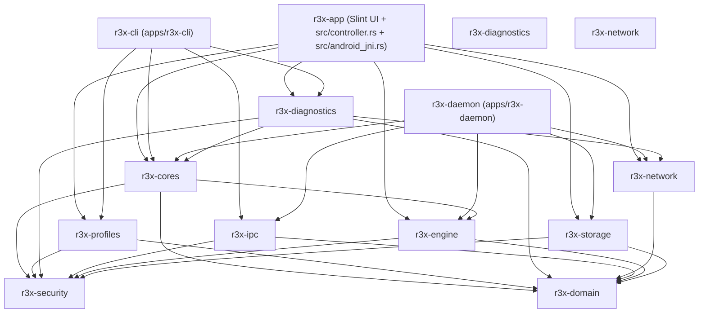

# R3X Core Architecture

**R3X (Rexy)** separates business rules, cryptography, persistence, local IPC, core orchestration, OS networking, diagnostics, and native Material 3 Expressive UI into a strict 11-crate Cargo workspace.

## 1. Crate Dependency Graph

## 2. Responsibility Matrix

| Crate | Path | Key Responsibility |
|---|---|---|
| `r3x-domain` | `crates/r3x-domain` | Pure data models (`Profile`, `Subscription`, `CoreManifest`, `ConnectionState`, `RoutingRule`, `DnsConfig`, `AppSettings`), `RedactedSecret`, `RingBuffer<T>`, typed `R3xError` codes |
| `r3x-security` | `crates/r3x-security` | `Redactor`, `extract_zip_safely` / `extract_targz_safely`, SHA-256 verification, Argon2id + XChaCha20-Poly1305 encrypted `.r3xbak` envelopes, 256-bit constant-time IPC tokens, URL & filename validation |
| `r3x-storage` | `crates/r3x-storage` | SQLite WAL repository (`R3xDatabase`), forward-only `schema_migrations`, `PRAGMA quick_check` corruption quarantine recovery, `SecretStore` abstraction (Credential Manager, Linux Secret Service, Android Keystore JNI bridge) |
| `r3x-ipc` | `crates/r3x-ipc` | Versioned (`IPC_PROTOCOL_VERSION = 1`), 4 MiB max length-prefixed JSON protocol over Windows Named Pipes (`interprocess`) and Linux `0600` Unix Domain Sockets |
| `r3x-engine` | `crates/r3x-engine` | `R3xEngine`, 10-state FSM, `tokio::sync::Mutex` single-flight connect/disconnect serialization, `CancellationToken` rollback, `CoreAdapter` trait, `CoreSelector`, bounded `LogHub` & `EngineEvent` broadcast |
| `r3x-profiles` | `crates/r3x-profiles` | URI parser & exporter, multi-format importer (Base64, SIP008/Xray/sing-box JSON, Clash YAML via `serde-saphyr`, WireGuard/AWG INI, `.ovpn`), untrusted `Subscription-Userinfo` header parsing, QR SVG encode + PNG decode |
| `r3x-cores` | `crates/r3x-cores` | `CoreManager`, 14 JSON core manifests (`resources/core-manifests/*.json`), SHA-256 binary installation/rollback, `SupervisedProcess` lifecycle, 19 `CoreAdapter` implementations |
| `r3x-network` | `crates/r3x-network` | Transactional `SystemProxyManager` with startup recovery, `KillSwitchManager`, `check_tun_capability`, `NetworkInterfaceInfo`, local port checks |
| `r3x-diagnostics` | `crates/r3x-diagnostics` | `RoutingManager`, `DnsManager` + leak/probe checks, 16-check `NetworkDoctor`, `TelemetryHub` (`sysinfo` + SVG path builders) |
| `r3x-daemon` | `apps/r3x-daemon` | Authenticated local IPC server orchestrating engine + all 19 core adapters + transactional network state recovery |
| `r3x-cli` | `apps/r3x-cli` | Headless CLI (`version`, `cores`, `profiles`, `connect`, `disconnect`, `status`, `diagnostics`) with `--json` output |
| `r3x-app` | `src/` & `ui/` | Native Slint 1.19 + Material 3 Expressive GUI (`r3x-app` binary + `r3x_app_lib` cdylib for Android), SQLite/controller bridge, `DesktopTrayHandle`, Android JNI hooks |

## 3. Connection Engine 10-State FSM

`ConnectionState::can_transition_to()` enforces valid state transitions:

`Disconnected` -> `Preparing` -> `Validating` -> `StartingCore` -> (`EstablishingTunnel` for TUN/Mixed or `Connecting` for Proxy) -> `Connecting` -> `Connected` (only after `CoreAdapter::health_check().is_ready()`) -> `Disconnecting` -> `Disconnected` (or `Reconnecting` -> `Preparing`, and `Error` on checked failure).
