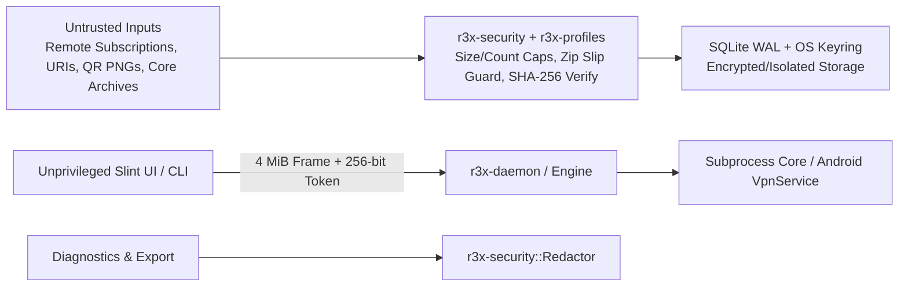

# R3X Threat Model

## 1. Assets Protected

1. Proxy credentials (UUIDs, Trojan/Shadowsocks passwords, WireGuard/AmneziaWG private keys, OpenVPN auth credentials).
2. Subscription URLs and auth query tokens.
3. User browsing traffic and DNS queries while tunnel is active.
4. Host network configuration (OS proxy settings, routes, DNS resolvers).
5. Client integrity (downloaded core binaries, runtime IPC channel, local database).

## 2. Trust Boundaries

## 3. Mitigated Threats

| Threat | Mitigation in Codebase | Verification |
|---|---|---|
| Secret leak in UI logs / support exports | `r3x_security::Redactor` scrubs userinfo, bearer tokens, JSON/YAML/INI secrets, query tokens before storage/export | `security_tests`, `diagnostics_tests`, `ui_smoke`, `fuzz_redactor` |
| Zip-slip / symlink / decompression bomb in core/backup archives | `extract_zip_safely` & `extract_targz_safely` enforce canonical relative paths, zero symlinks, file count & uncompressed byte caps, SHA-256 verification | `security_tests`, `cores_tests` |
| Local IPC hijacking or OOM DoS | `0600` Unix socket / scoped Named Pipe, constant-time 256-bit token comparison (`subtle`), pre-alloc `4 MiB` cap, version checks | `ipc_tests`, `fuzz_ipc_frame` |
| Poisoned subscription payload / metadata crash | Strict `10 MiB` bound, parser limits, failed refreshes preserve prior SQLite rows | `profiles_tests`, `fuzz_uri_parser`, `fuzz_import_payload` |
| Stale proxy hijacking OS internet after crash | Transactional `SystemProxyManager` snapshot + `recover_network_state()` on startup | `network_tests` |
| MITM / insecure TLS defaults | `rustls` + WebPKI roots; `allow_insecure` is opt-in only and surfaced visually; broken `PPTP` / cleartext `L2TP` hard-blocked | `cores_tests` |
| Credential exposure on disk when Secret Service absent | `R3xError::SecretStoreUnavailable` fails closed instead of silent plaintext storage | `storage_tests` |
| GPL-2.0 / GPL-3.0 license contamination | `OpenVpnAdapter` strictly out-of-process CLI; `deny.toml` enforces crate license policy + bans OpenSSL/`serde_yaml` | `cargo deny check licenses bans sources` |

## 4. Residual Risks & Operational Caveats

- Upstream third-party proxy cores run as external binaries (desktop) or bundled engines and handle packet parsing in Go/C++/C; R3X constrains their working directories, validates SHA-256 digests against manifests, and never grants proxy listeners public `0.0.0.0` access unless LAN sharing is explicitly opted into.
- OS firewall rules outside R3X or third-party VPN mesh tools can race with system routing; **Network Doctor** explicitly warns on active conflicts.
